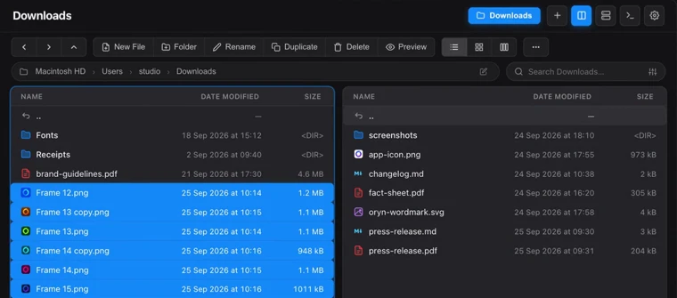

  

## SE · Cybersecurity enthusiast

I’m studying **Security and Continuity of IT**. I build desktop tools and native apps.

### Projects

**[Oryn](https://github.com/kaventro/Oryn)** — a keyboard-driven, dual-pane file manager for macOS, Windows, and Linux.

- **[motion-designer](https://github.com/kaventro/motion-designer)** — turns real app screens into launch videos cut to music.
- **[notion-sync](https://github.com/kaventro/notion-sync)** — syncs Obsidian vaults with Notion, including links and attachments.

### GitHub activity

  <picture>
    <source media="(prefers-color-scheme: dark)" srcset="profile/snake-dark.svg">
    
  </picture>

